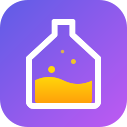
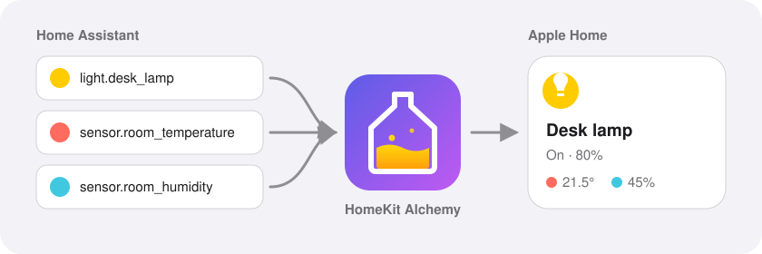

<div align="center">



# HomeKit Alchemy

**Превращает любые сущности Home Assistant в устройства Apple Home — ровно такими, как вам нужно.**

[](https://hacs.xyz)
[](https://www.home-assistant.io)
[](https://github.com/vancho-go/homekit-alchemy)
[](https://github.com/vancho-go/homekit-alchemy/actions/workflows/tests.yml)
[](https://github.com/vancho-go/homekit-alchemy/actions/workflows/validate.yml)
[](LICENSE)

[English](README.md) · **Русский**

</div>

<p align="center">
  
</p>

Штатный HomeKit Bridge в Home Assistant показывает **одну сущность как одно устройство**. HomeKit Alchemy позволяет **собирать** устройства: берёте лампу, добавляете датчик температуры с другого устройства, батарейку с третьего, переключатель «Тихий режим», который запускает скрипт, — и «Дом» видит **одно** устройство.

<table>
<tr>
<td width="33%" valign="top">

### 🧩 Собирайте
Любые блоки из любых сущностей — в одной карточке «Дома».

</td>
<td width="33%" valign="top">

### 🎛️ Свои кнопки
Свои переключатели, ползунки, списки режимов и кнопки — на любые действия.

</td>
<td width="33%" valign="top">

### 📺 ТВ и пульт
Входы, громкость и пульт iPhone для любого `media_player`.

</td>
</tr>
<tr>
<td valign="top">

### ⚡ Старт без настройки
Обычные устройства работают сразу; в YAML меняется любая деталь.

</td>
<td valign="top">

### 🏠 Всё локально
Без облака, без Homebridge, без аддонов.

</td>
<td valign="top">

### 🤝 Без конфликтов
Работает рядом со штатным HomeKit Bridge — переносите устройства по одному.

</td>
</tr>
</table>

**[Установка](#-установка)** · **[Быстрый старт](#-быстрый-старт)** · **[Настройка](#-настройка)** · **[Доп. блоки](#-дополнительные-блоки)** · **[Типы устройств](#-типы-устройств)** · **[Рецепты](#-рецепты)** · **[Сервисы](#-сервисы-и-события)** · **[Особенности «Дома»](#-особенности-дома)** · **[Если не работает](#-если-что-то-не-работает)**

---

## ✨ Что можно собрать

<!-- screenshot: составная карточка в «Доме» (лампа + температура + влажность) -->

| В Home Assistant | В «Доме» |
|---|---|
| лампа + датчики комнаты | одна карточка лампы, а внутри температура и влажность |
| кондиционер + сущность «подсветка дисплея» + скрипты | кондиционер со скоростью вентилятора и вашими переключателями «Подсветка», «Осушение», «Вентиляция» |
| реле + геркон | гаражные ворота / калитка с реальным «открыто / закрыто» |
| `select` с режимами | подписанные переключатели режимов, ступенчатый ползунок или настоящий список |
| любой `number` | ползунок |
| беспроводная кнопка (`event.*`) | программируемый выключатель для автоматизаций «Дома» |
| телевизор (`media_player`) | ТВ как у Apple TV: входы, громкость и пульт в iPhone |

Из коробки: лампы, выключатели, розетки, датчики, термостаты, кондиционеры, водонагреватели, шторы, окна, двери, гаражные ворота, вентиляторы, очистители воздуха, увлажнители и осушители, замки, краны и полив, охранные системы, скрипты, сцены, кнопки и телевизоры.

---

## 📦 Установка

**Нужно:** Home Assistant **2026.10+**, iPhone / iPad в **той же локальной сети**.

> [!TIP]
> Домашний центр Apple (HomePod или Apple TV) не обязателен. Он нужен Apple только для управления вне дома, автоматизаций «Дома» и событий кнопок — всё остальное работает без него.

### Через HACS (рекомендуется)

[](https://my.home-assistant.io/redirect/hacs_repository/?owner=vancho-go&repository=homekit-alchemy&category=integration)

1. Нажмите кнопку выше — она откроет HomeKit Alchemy в HACS вашего Home Assistant.
2. Нажмите **Скачать**.
3. Перезапустите Home Assistant.

<details>
<summary><b>Без кнопки</b></summary>

HACS → ⋮ → **Пользовательские репозитории** → добавьте `https://github.com/vancho-go/homekit-alchemy`, категория **Интеграция** → найдите **HomeKit Alchemy** → **Скачать** → перезапустите Home Assistant.

</details>

<details>
<summary><b>Установка вручную</b></summary>

Скопируйте `custom_components/homekit_alchemy` в `<config>/custom_components/` и перезапустите Home Assistant.

</details>

---

## 🚀 Быстрый старт

**1.** Добавьте в `configuration.yaml` (или вынесите в отдельный файл через `homekit_alchemy: !include homekit_alchemy.yaml`):

```yaml
homekit_alchemy:
  filter:
    include_entities:
      - light.desk_lamp
      - climate.living_room_ac
```

**2.** Перезапустите Home Assistant. Интеграция создастся сама, а в уведомлении появятся **QR-код** и **код сопряжения**.

<!-- screenshot: уведомление HA с кодом -->

**3.** На iPhone: **Дом** → **+** → **Добавить аксессуар** → отсканируйте QR-код из уведомления. Или нажмите **Другие параметры…** → **HomeKit Alchemy** → введите код.

<!-- screenshot: список «Добавить аксессуар» с HomeKit Alchemy -->

> [!NOTE]
> Apple предупредит, что аксессуар не сертифицирован, — так бывает у любого некоммерческого HomeKit-проекта. Нажмите **Все равно добавить**.

**4.** Готово. Меняйте YAML когда угодно и применяйте без перезапуска: **Инструменты разработчика → YAML → HomeKit Alchemy**.

---

## 🔧 Настройка

Всё необязательно:

```yaml
homekit_alchemy:
  name: HomeKit Alchemy      # имя моста в «Доме»
  port: 21100                # порт моста; ТВ и списки занимают следующие (21101, 21102…)
  filter: { … }              # какие сущности показывать
  entity_config:             # как их показывать
    light.desk_lamp: { … }
```

### Какие сущности показывать — `filter`

Правила те же, что у фильтров самого Home Assistant:

```yaml
homekit_alchemy:
  filter:
    include_domains: [light, climate, cover]
    include_entities: [switch.kettle]
    include_entity_globs: ["sensor.*_temperature"]
    exclude_entities: [light.night_lamp]
    exclude_entity_globs: ["*_child_lock"]
```

- Всё из `entity_config` показывается, даже если фильтр о нём не говорит (если только не исключено явно).
- Скрытые и служебные (настройки / диагностика) сущности показываются, только если указаны по имени.
- Сущности, которые нельзя показать (например, `sensor` мощности), молча пропускаются, если попали через целый домен, и с предупреждением в логе — если указаны явно.

### Настройка устройства — `entity_config`

Ключ — **главная сущность** устройства, всё остальное прикрепляется к ней.

```yaml
homekit_alchemy:
  entity_config:
    light.desk_lamp:
      name: Настольная лампа   # имя в «Доме»
      type: light              # как показывать, см. Типы устройств
      sensors: [ … ]           # дополнительные блоки, см. ниже
      switches: [ … ]
      ranges: [ … ]
      modes: [ … ]
      buttons: [ … ]
```

> [!TIP]
> Если потом переименовать сущность в Home Assistant, устройство в «Доме» не сломается — оно отслеживается по внутреннему ID сущности.

### Значения и действия

Везде, где нужно **значение**:

```yaml
state: sensor.reed_switch                                   # состояние сущности
state: { entity: climate.ac, attribute: current_humidity }  # атрибут
state: "{{ is_state('switch.beeper', 'off') }}"             # шаблон
```

Везде, где нужно **действие**:

```yaml
turn_on:
  action: climate.set_preset_mode
  entity_id: climate.ac          # короткая запись для target.entity_id
  data: { preset_mode: quiet }
```

В действиях `ranges` доступно `{{ value }}`, в действиях `modes` — `{{ option }}`.

---

## 🧩 Дополнительные блоки

### `sensors` — показания с других сущностей

<!-- screenshot: карточка с блоками температуры, влажности и батарейки -->

```yaml
sensors:
  - type: temperature
    entity: sensor.room_temperature
  - type: humidity
    entity: sensor.room_humidity
    name: Влажность в комнате
  - type: battery
    entity: sensor.motion_battery
```

<details>
<summary><b>Все типы датчиков</b></summary>

| `type` | Что показывает | Примечания |
|---|---|---|
| `temperature`, `humidity`, `illuminance` | значение | °F переводятся автоматически |
| `co2` | уровень CO₂ | выше 1000 ppm — «превышение» |
| `pm25`, `pm10` | качество воздуха + концентрация | уровни как в Home Assistant |
| `motion`, `occupancy`, `contact`, `leak`, `smoke`, `co` | детектор | подходит любое значение вида вкл/выкл |
| `battery` | заряд, «низкий» ниже 20 % | виден у устройств-датчиков, не у ламп |
| `filter_life`, `filter_change` | состояние фильтра | «Смените фильтр скоро» ниже 10 % |

Каждый датчик принимает `entity` (+ необязательно `attribute`) или `template`, а также необязательные `name` / `id`.

</details>

### `switches` — свои переключатели

<!-- screenshot: карточка кондиционера с переключателями «Подсветка» / «Осушение» -->

```yaml
switches:
  - name: Подсветка
    entity: light.ac_display              # состояние и вкл/выкл берутся из сущности
  - name: Тихий режим
    state: "{{ is_state_attr('climate.ac', 'preset_mode', 'quiet') }}"
    turn_on: { action: climate.set_preset_mode, entity_id: climate.ac, data: { preset_mode: quiet } }
    turn_off: { action: climate.set_preset_mode, entity_id: climate.ac, data: { preset_mode: none } }
```

Без `state` переключатель запоминает последнюю команду.

### `ranges` — любое число как ползунок

<!-- screenshot: ползунок-«лампа» -->

Показывается как лампа с яркостью: 0 % = `min`, 100 % = `max`. Выключение «лампы» ставит `min`, включение возвращает прежнее значение.

```yaml
ranges:
  - name: Яркость дисплея
    entity: number.display_brightness    # min, max, step и действие берутся из number / input_number
  - name: Громкость
    state: { entity: media_player.speaker, attribute: volume_level }
    min: 0
    max: 1
    step: 0.05
    set: { action: media_player.volume_set, entity_id: media_player.speaker, data: { volume_level: "{{ value }}" } }
```

### `modes` — выбор из списка

<!-- screenshot: три вида режимов рядом (переключатели / ползунок / телевизор) -->

```yaml
modes:
  - name: Режим
    entity: select.humidifier_mode        # варианты и действие берутся из select / input_select
    options:                              # необязательно: подписи, порядок, подмножество
      auto: Авто
      silent: Тихий
  - name: Скорость
    state: sensor.fan_speed
    options: [low, medium, high]
    set: { action: script.set_speed, data: { speed: "{{ option }}" } }
    display: slider
```

| `display` | Как выглядит | Когда подходит |
|---|---|---|
| `switches` *(по умолчанию)* | подписанный переключатель на каждый вариант | любое количество вариантов; удобно для сцен и Siri |
| `slider` | ползунок-лампа со ступеньками | упорядоченные варианты (низкий → высокий) |
| `television` | настоящий список с выбором одного | когда нужен именно список — становится **отдельным аксессуаром** со своим кодом |

> [!WARNING]
> YAML превращает `on` / `off` / `yes` / `no` без кавычек в true / false. В `options` они превращаются обратно в `"on"` / `"off"`, в остальных местах берите их в кавычки.

### `buttons` — события для автоматизаций «Дома»

<!-- screenshot: блоки кнопок «Кнопка 1 — Одно нажатие» -->

```yaml
buttons:
  - name: Выключатель у двери
    entity: event.wall_switch       # у event.* тип нажатия — атрибут event_type
    single: single                  # значение или список значений
    double: double
    long: [hold, long_press]
  - name: Пульт
    entity: sensor.remote_action    # у остальных сущностей — состояние (или attribute:)
    single: arrow_left_click
```

Каждая кнопка становится «программируемым выключателем» Apple: одно / двойное / долгое нажатие. Сущность `event.*` можно отдать и саму по себе через `filter` — типы нажатий угадываются по её `event_types`.

> [!IMPORTANT]
> Автоматизации по кнопкам «Дом» выполняет только при наличии **домашнего центра**.

---

## 📚 Типы устройств

Тип выбирается автоматически; чтобы показать сущность иначе, укажите `type:`.

<details open>
<summary><b>Домены, значения по умолчанию и параметры</b></summary>

| Домен | По умолчанию в «Доме» | Другие значения `type:` | Доп. параметры |
|---|---|---|---|
| `light` | лампа (яркость, цвет, цветовая температура) | `switch`, `outlet` | `state`, `turn_on`, `turn_off` |
| `switch`, `input_boolean` | выключатель | `outlet`, `light`, `garage_door`, `window_covering`, `window`, `door`, `valve`, `sprinkler`, `shower`, `faucet` | `state`, `turn_on`, `turn_off`, параметры штор |
| `sensor` | по `device_class` | любой тип датчика, кроме `battery` | `state` |
| `binary_sensor` | по `device_class` (`door`/`window` → открытие, `moisture` → протечка, …) | любой тип детектора | `state` |
| `climate` | `heater_cooler`, если умеет охлаждать, иначе `thermostat` | `thermostat`, `heater_cooler` | `current_temperature`, `current_humidity`¹, `min_temp`, `max_temp`, `temperature_step` |
| `water_heater` | термостат (выкл / нагрев) | — | `current_temperature`, `min_temp`, `max_temp` |
| `cover` | штора, либо `window` / `door` / `garage_door` по `device_class` | `window_covering`, `window`, `door`, `garage_door` | `state`, `open`, `close`, `stop`, `obstruction` |
| `fan` | вентилятор (скорость, направление, качание, пресеты переключателями) | `air_purifier` | `presets` |
| `humidifier` | увлажнитель или осушитель (режимы переключателями) | — | `current_humidity`, `presets` |
| `lock` | замок | — | `code` |
| `valve` | кран | `sprinkler`, `shower`, `faucet` | — |
| `alarm_control_panel` | охрана (дома / не дома / ночь / выкл) | — | `code` |
| `media_player` | ТВ, если это ТВ / ресивер или умеет выбирать источник, иначе выключатель питания | `television`, `receiver`, `switch` | `sources`, `remote_keys` |
| `script`, `scene`, `button`, `input_button` | переключатель, который запускает и сам выключается | — | — |
| `event` | программируемый выключатель | — | `buttons` |

¹ только для `thermostat`; для `heater_cooler` добавьте `sensors: - type: humidity`.

</details>

### 🎚️ Режимы вентиляторов и увлажнителей

Их режимы становятся переключателями с названиями из Home Assistant. Переименовать, упорядочить или скрыть их можно через `presets:` — показываются только перечисленные:

```yaml
humidifier.bedroom:
  presets:
    Constant Humidity: Постоянная влажность
    Sleep: Сон
    Strong: Сильный        # «Off» не указан — не показывается
```

### ❄️ Климат

<!-- screenshot: карточка кондиционера с регулятором скорости вентилятора -->

У кондиционеров внутри карточки появляется регулятор скорости вентилятора. У режимов `dry` и `fan_only` нет аналога у Apple — добавьте их через `switches` ([рецепт](#кондиционер-с-дополнительными-режимами)).

### 📺 Телевизоры

<!-- screenshot / GIF: карточка ТВ со входами + пульт iPhone -->

ТВ — **отдельный аксессуар** (так требует Apple): добавьте его в «Дом» по отдельному коду из уведомления. Входы берутся из `source_list`; переименовать, упорядочить или скрыть их можно через `sources:`. Пульт в iPhone («Пункт управления» → «Пульт Apple TV») отправляет плееру play/pause и следующий / предыдущий трек; стрелки, OK, «назад» и «инфо» выполняют ваши действия из `remote_keys:` или генерируют событие.

```yaml
media_player.living_room_tv:
  sources:
    HDMI 1: Приставка
    Netflix: Netflix
  remote_keys:
    arrow_up: { action: remote.send_command, entity_id: remote.living_room_tv, data: { command: UP } }
```

<details>
<summary><b>Имена клавиш пульта</b></summary>

`arrow_up`, `arrow_down`, `arrow_left`, `arrow_right`, `select`, `back`, `exit`, `information`, `play_pause`, `next_track`, `previous_track`, `rewind`, `fast_forward`

</details>

---

## 🧪 Рецепты

#### Лампа, которая показывает климат в комнате

```yaml
light.desk_lamp:
  name: Настольная лампа
  sensors:
    - { type: temperature, entity: sensor.room_temperature }
    - { type: humidity, entity: sensor.room_humidity }
```

#### Кондиционер с дополнительными режимами

```yaml
climate.living_room_ac:
  name: Кондиционер
  max_temp: 30                                  # исправляет неверный диапазон от устройства
  current_temperature: sensor.room_temperature  # брать температуру с более точного датчика
  switches:
    - name: Подсветка
      entity: light.living_room_ac_display
    - name: Осушение
      state: "{{ is_state('climate.living_room_ac', 'dry') }}"
      turn_on:  { action: climate.set_hvac_mode, entity_id: climate.living_room_ac, data: { hvac_mode: dry } }
      turn_off: { action: climate.set_hvac_mode, entity_id: climate.living_room_ac, data: { hvac_mode: "off" } }
```

#### Ворота на реле с герконом

```yaml
switch.gate_relay:
  name: Ворота
  type: garage_door
  state: binary_sensor.gate_reed          # on = открыто
  open:  { action: switch.turn_on, entity_id: switch.gate_relay }
  close: { action: switch.turn_on, entity_id: switch.gate_relay }
  obstruction: binary_sensor.gate_photocell
```

#### Очиститель воздуха с качеством воздуха и фильтром

```yaml
fan.purifier:
  type: air_purifier
  sensors:
    - { type: pm25, entity: sensor.purifier_pm25 }
    - { type: filter_life, entity: sensor.purifier_filter_life }
```

#### Метеостанция

```yaml
sensor.outdoor_temperature:
  name: Погода
  sensors:
    - { type: humidity, entity: sensor.outdoor_humidity }
    - { type: battery, entity: sensor.outdoor_battery }
```

---

## 🧰 Сервисы и события

| Сервис | Что делает |
|---|---|
| `homekit_alchemy.reload` | перечитывает YAML без перезапуска; YAML с ошибкой отклоняется, работающая конфигурация остаётся |
| `homekit_alchemy.reset_accessory` | заставляет «Дом» забыть выбранные устройства и добавить их заново — лечит устаревший вид. Комнату и сцены придётся назначить заново |
| `homekit_alchemy.unpair` | забывает все сопряжённые iPhone / iPad — у моста и у всех отдельных аксессуаров |

**Событие** `homekit_alchemy_tv_remote_key_pressed` (`entity_id`, `key`) — клавиша пульта iPhone без действия в `remote_keys:`.

**Диагностика:** Настройки → Устройства и службы → HomeKit Alchemy → ⋮ → **Скачать диагностику**. Коды сопряжения и коды замков туда не попадают.

---

## 🍏 Особенности «Дома»

> [!IMPORTANT]
> **Комнату нельзя задать в YAML.** В протоколе Apple для мостов нет такого поля. Выберите комнату в «Доме» один раз — она сохраняется при перезапусках, перезагрузке конфигурации и обновлениях.

> [!TIP]
> **«Дом» кэширует, как выглядит устройство.** Новые блоки, переименования и значения подхватываются сами, но если блоки *перегруппированы*, старый вид может остаться. Выполните `homekit_alchemy.reset_accessory` для этого устройства.

- **Батарейка** видна у устройств-датчиков («Статус → Уровень заряда»), но не у ламп.
- **Вентиляторы внутри карточки не подписываются** — поэтому ползунки режимов сделаны «лампами». **Качание** скрыто у вентиляторов кондиционеров и у некоторых вентиляторов.
- **Телевизоры и списки `display: television`** — отдельные аксессуары со своим кодом и своей комнатой.
- **Роботы-пылесосы** попадают в «Дом» только через Matter — не поддерживаются. **Камеры** пока не поддерживаются; оставьте их в штатном HomeKit Bridge.
- Кириллица в «Доме» отображается нормально; в списке «Добавить аксессуар» имена транслитерируются (например, «Gostinaya TV»).

---

## 🩺 Если что-то не работает

<details>
<summary><b>Мост не находится при добавлении</b></summary>

iPhone должен быть в той же сети. Home Assistant должен быть доступен по **TCP 21100+** (порт моста и следующие для ТВ) и **UDP 5353** (mDNS). Не разносите Home Assistant и iPhone по разным VLAN без mDNS-репитера.

</details>

<details>
<summary><b>«Нет ответа»</b></summary>

Проверьте, что главная сущность не `unavailable`. Затем посмотрите лог и скачайте диагностику. Подробный лог:

```yaml
logger:
  logs:
    custom_components.homekit_alchemy: debug
```

</details>

<details>
<summary><b>Устройство выглядит не так после изменения</b></summary>

Выполните для него `homekit_alchemy.reset_accessory`.

</details>

<details>
<summary><b>Начать с нуля</b></summary>

Удалите мост в «Доме», удалите интеграцию в Home Assistant (это удаляет её данные сопряжения), добавьте заново.

</details>

---

## ✅ Что проверено

| Тип устройств | Реальное устройство | Демо-устройство | Автотесты |
|---|:---:|:---:|:---:|
| Лампы, выключатели, датчики, составные устройства | ✅ | ✅ | ✅ |
| Термостаты, кондиционеры | ✅ | | ✅ |
| Шторы, окна, двери, гаражные ворота | | ✅ | ✅ |
| Вентиляторы, очистители | | ✅ | ✅ |
| Увлажнители, замки, краны, охрана, водонагреватели, скрипты / сцены / кнопки | | ✅ | ✅ |
| Ползунки, режимы, кнопки, ТВ-списки | | ✅ | ✅ |
| Телевизоры (`media_player`) | | ✅ | ✅ |

Проверено на Home Assistant 2026.10 и iOS 26. Отчёты с ваших устройств очень приветствуются — [создайте issue](https://github.com/vancho-go/homekit-alchemy/issues) и приложите диагностику.

---

## 🤝 Участие в разработке

```bash
python -m venv .venv
.venv/bin/pip install -r requirements_test.txt
.venv/bin/python -m pytest
```

Issues и pull request'ы приветствуются.

## 📄 Лицензия

[MIT](LICENSE)
